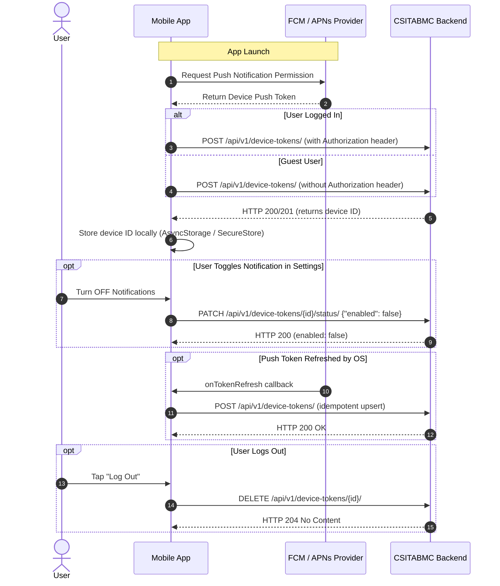

# Mobile Push Notification Device Token API & Integration Guide

Welcome to the backend Push Notification Device Token API documentation for the **CSIT Association of BMC Mobile Application**.

This document is self-contained. You do not need to inspect the Django backend code to integrate these endpoints into your mobile application (React Native / Flutter / Native iOS / Native Android).

---

## Table of Contents
1. [Overview](#1-overview)
2. [Base URLs & Environment Setup](#2-base-urls--environment-setup)
3. [Authentication](#3-authentication)
4. [Endpoint Reference](#4-endpoint-reference)
   - [A. Register Device Token (`POST /api/v1/device-tokens/`)](#a-register-device-token)
   - [B. Update Notification Status (`PATCH /api/v1/device-tokens/{id}/status/`)](#b-update-notification-status)
   - [C. List Registered Devices (`GET /api/v1/device-tokens/`)](#c-list-registered-devices)
   - [D. Retrieve Specific Device (`GET /api/v1/device-tokens/{id}/`)](#d-retrieve-specific-device)
   - [E. Update/Refresh Token Value (`PATCH /api/v1/device-tokens/{id}/`)](#e-updaterefresh-token-value)
   - [F. Unregister Device (`DELETE /api/v1/device-tokens/{id}/`)](#f-unregister-device)
5. [Mobile Integration Workflow](#5-mobile-integration-workflow)
6. [Notification Preference Behavior](#6-notification-preference-behavior)
7. [Token Refresh Handling](#7-token-refresh-handling)
8. [Error Handling & Status Codes](#8-error-handling--status-codes)
9. [Security Best Practices](#9-security-best-practices)
10. [Complete Integration Code Examples](#10-complete-integration-code-examples)
11. [Integration Checklist](#11-integration-checklist)

---

## 1. Overview

The Device Token API allows mobile devices to register their push notification hardware tokens (FCM for Android, APNs for iOS) with the CSITABMC backend.

### Key Capabilities:
- **Idempotent Registration**: Calling the registration endpoint multiple times will never create duplicate database records.
- **Seamless Account Association**: Tokens can be registered by guest users or attached to authenticated member accounts. If an authenticated user logs in on a previously registered device, the backend automatically reassigns device ownership to their account.
- **Preference Control**: Users can toggle push notifications on or off in the mobile app settings without deleting the device registration.
- **Targeted Notification Ready**: The backend strictly excludes disabled device tokens from push delivery queues.

### Supported Platforms:
- `"android"` — Google Firebase Cloud Messaging (FCM) tokens.
- `"ios"` — Apple Push Notification Service (APNs) or FCM on iOS tokens.

*(Platform values are case-insensitive and normalized to lowercase on the server).*

---

## 2. Base URLs & Environment Setup

| Environment | Base URL |
|---|---|
| **Local Development (Emulator/Device)** | `http://<YOUR_LOCAL_IP>:8000` (e.g. `http://192.168.1.100:8000` or `http://10.0.2.2:8000` for Android emulator) |
| **Staging / QA** | `https://staging-api.csitabmc.org` *(placeholder)* |
| **Production** | `https://api.csitabmc.org` *(placeholder)* |

### Endpoint Path Structure:
All device token endpoints are rooted under:
```
/api/v1/device-tokens/
```

---

## 3. Authentication

The backend uses **JSON Web Tokens (JWT)** via `CookieJWTAuthentication`. 

### Authorization Header
For mobile application requests, include the user's JWT access token in the `Authorization` header:

```http
Authorization: Bearer <ACCESS_TOKEN>
```

### Authentication Rules by Endpoint:
| Endpoint | Method | Auth Required? | Behavior |
|---|---|---|---|
| `/api/v1/device-tokens/` | `POST` | **Optional** | If `Authorization` header is present, token is associated with the user account. If omitted, token is stored as a guest device. |
| `/api/v1/device-tokens/{id}/status/` | `PATCH` | **Required (for user devices)** | Caller must own the device record or be an admin. Guest tokens can be toggled by anonymous clients. |
| `/api/v1/device-tokens/` | `GET` | **Required** | Returns all registered devices owned by the authenticated user. Admins receive all devices across users. |
| `/api/v1/device-tokens/{id}/` | `GET` | **Required** | Retrieves device details for the owner. |
| `/api/v1/device-tokens/{id}/` | `PATCH` | **Required** | Updates refreshed token value for the owner. |
| `/api/v1/device-tokens/{id}/` | `DELETE` | **Required** | Unregisters the device record. |

---

## 4. Endpoint Reference

### A. Register Device Token
Register a new mobile push token or re-register an existing token upon app launch or token rotation.

- **Method**: `POST`
- **Path**: `/api/v1/device-tokens/`
- **Auth**: Optional (`Authorization: Bearer <token>` if user is signed in)
- **Content-Type**: `application/json`

#### Request Body:
```json
{
  "token": "dK4X8...f9ZqP",
  "platform": "android"
}
```

#### Field Specifications:
| Field | Type | Required | Description |
|---|---|---|---|
| `token` | String | Yes | Unique push token string from FCM or APNs (max 512 chars). |
| `platform` | String | Yes | `"android"` or `"ios"`. |

#### Successful Response (New Device - HTTP 201 Created):
```json
{
  "success": true,
  "message": "Device token registered successfully.",
  "data": {
    "id": 14,
    "platform": "android",
    "enabled": true
  }
}
```

#### Successful Response (Existing Device Re-registered - HTTP 200 OK):
```json
{
  "success": true,
  "message": "Device token updated successfully.",
  "data": {
    "id": 14,
    "platform": "android",
    "enabled": true
  }
}
```

#### Error Response (Validation Failure - HTTP 400 Bad Request):
```json
{
  "success": false,
  "message": "Validation failed.",
  "errors": {
    "platform": [
      "Unsupported platform 'windows'. Supported platforms: android, ios."
    ]
  }
}
```

---

### B. Update Notification Status
Allows the user to enable or disable push notifications in mobile settings.

- **Method**: `PATCH`
- **Path**: `/api/v1/device-tokens/{id}/status/`
- **Auth**: Required (`Authorization: Bearer <token>`)
- **Content-Type**: `application/json`

#### Request Body (Disable Notifications):
```json
{
  "enabled": false
}
```

#### Request Body (Enable Notifications):
```json
{
  "enabled": true
}
```

#### Field Specifications:
| Field | Type | Required | Description |
|---|---|---|---|
| `enabled` | Boolean | Yes | `true` to receive notifications, `false` to opt out. |

*(Any other fields passed in the request body are strictly ignored and will not alter the token or account ownership).*

#### Successful Response (HTTP 200 OK):
```json
{
  "success": true,
  "message": "Push notifications disabled successfully.",
  "data": {
    "id": 14,
    "enabled": false
  }
}
```

#### Error Response (Forbidden / Not Owned - HTTP 403 Forbidden):
```json
{
  "detail": "You do not have permission to perform this action."
}
```

---

### C. List Registered Devices
Retrieve a list of device tokens owned by the authenticated user.

- **Method**: `GET`
- **Path**: `/api/v1/device-tokens/`
- **Auth**: Required (`Authorization: Bearer <token>`)
- **Optional Query Parameters**:
  - `?platform=android` or `?platform=ios`
  - `?enabled=true` or `?enabled=false`

#### Successful Response (HTTP 200 OK):
```json
{
  "success": true,
  "count": 2,
  "data": [
    {
      "id": 14,
      "platform": "android",
      "enabled": true,
      "masked_token": "dK4X81a2...f9ZqP0",
      "user_id": 5,
      "username": "bibek_acharya",
      "created_at": "2026-11-02T08:15:30.123456Z",
      "updated_at": "2026-11-02T08:15:30.123456Z"
    },
    {
      "id": 19,
      "platform": "ios",
      "enabled": false,
      "masked_token": "8a71f0bc...3e1a09",
      "user_id": 5,
      "username": "bibek_acharya",
      "created_at": "2026-10-15T12:00:00.000000Z",
      "updated_at": "2026-11-01T14:22:10.000000Z"
    }
  ]
}
```

---

### D. Retrieve Specific Device
Fetch registration metadata for a single device token.

- **Method**: `GET`
- **Path**: `/api/v1/device-tokens/{id}/`
- **Auth**: Required (`Authorization: Bearer <token>`)

#### Successful Response (HTTP 200 OK):
```json
{
  "success": true,
  "data": {
    "id": 14,
    "platform": "android",
    "enabled": true,
    "masked_token": "dK4X81a2...f9ZqP0",
    "user_id": 5,
    "username": "bibek_acharya",
    "created_at": "2026-11-02T08:15:30.123456Z",
    "updated_at": "2026-11-02T08:15:30.123456Z"
  }
}
```

---

### E. Update/Refresh Token Value
Update the push token string when the mobile OS provider rotates it.

- **Method**: `PATCH`
- **Path**: `/api/v1/device-tokens/{id}/`
- **Auth**: Required (`Authorization: Bearer <token>`)
- **Content-Type**: `application/json`

#### Request Body:
```json
{
  "token": "NEW_REFRESHED_FCM_TOKEN_STRING"
}
```

#### Successful Response (HTTP 200 OK):
```json
{
  "success": true,
  "message": "Device token updated successfully.",
  "data": {
    "id": 14,
    "platform": "android",
    "enabled": true
  }
}
```

---

### F. Unregister Device
Remove a device token upon application logout or when the user unregisters the device.

- **Method**: `DELETE`
- **Path**: `/api/v1/device-tokens/{id}/`
- **Auth**: Required (`Authorization: Bearer <token>`)

#### Successful Response:
- **Status**: `HTTP 204 No Content` (Empty body)

---

## 5. Mobile Integration Workflow

Follow this standard lifecycle sequence in your mobile app:



---

## 6. Notification Preference Behavior

| Setting | Backend Behavior | Push Delivery Impact |
|---|---|---|
| `enabled: true` | Device record is marked active. | **Included** in all broadcast and user-targeted notifications. |
| `enabled: false` | Device record is retained, `enabled` is set to `false`. | **Strictly excluded** from all push delivery queries. |

### Important Rules:
1. **Disabling notifications does NOT delete the token.** The record remains intact so that if the user toggles notifications back on, no re-registration is needed.
2. If notifications are disabled and the app sends a new `POST /api/v1/device-tokens/` registration call, the backend treats this as an explicit re-activation and sets `enabled: true`.

---

## 7. Token Refresh Handling

Firebase and APNs periodically rotate push tokens (e.g. app restore, backup migration, provider key rotation).

### How to handle in your app:
1. Listen to your notification library's token refresh callback:
   - React Native Firebase: `messaging().onTokenRefresh(token => { ... })`
   - Expo: `Notifications.addPushTokenListener(...)`
2. When a new token is received, call `POST /api/v1/device-tokens/` with the new token.
3. The backend updates the record in-place and returns the ID.

---

## 8. Error Handling & Status Codes

| Status Code | Meaning | Cause / Recommended Mobile Action |
|---|---|---|
| **200 OK** | Success | Existing token updated or status toggled successfully. |
| **201 Created** | Created | New device token registered successfully. |
| **204 No Content** | Deleted | Device token deleted upon unregistration. |
| **400 Bad Request** | Validation Error | Missing token, unsupported platform, or invalid boolean in request body. Inspect `errors` dictionary in response. |
| **401 Unauthorized** | Unauthenticated | Missing or expired JWT access token. Refresh user access token and retry. |
| **403 Forbidden** | Access Denied | The caller is attempting to view, modify, or delete a token owned by another account. |
| **404 Not Found** | Record Missing | The requested device token ID does not exist in the database. |
| **500 Server Error** | Internal Error | Unexpected backend exception. Contact backend team if persistent. |

### Standard Validation Error Format (HTTP 400):
```json
{
  "success": false,
  "message": "Validation failed.",
  "errors": {
    "token": [
      "Push notification device token cannot be blank."
    ]
  }
}
```

---

## 9. Security Best Practices

1. **Always use HTTPS in Staging and Production.** Never send device push tokens over plaintext HTTP.
2. **Never expose or log full push tokens in debug tools.** The backend masks tokens (`dK4X...f9Zq`) in GET and admin views.
3. **Never attempt to send another user's ID.** Device ownership is determined strictly by the server from the validated JWT `Authorization` header.
4. **Store Access Tokens Securely.** Use `react-native-keychain`, `expo-secure-store`, or Android Keystore / iOS Keychain.

---

## 10. Complete Integration Code Examples

### A. cURL Examples

#### 1. Register a Device Token (Authenticated User)
```bash
curl -X POST "http://localhost:8000/api/v1/device-tokens/" \
  -H "Authorization: Bearer <YOUR_JWT_ACCESS_TOKEN>" \
  -H "Content-Type: application/json" \
  -d '{
    "token": "eXamPLe_Fcm_TOkEn_vALuE_1234567890",
    "platform": "android"
  }'
```

#### 2. Disable Notifications for Device #14
```bash
curl -X PATCH "http://localhost:8000/api/v1/device-tokens/14/status/" \
  -H "Authorization: Bearer <YOUR_JWT_ACCESS_TOKEN>" \
  -H "Content-Type: application/json" \
  -d '{"enabled": false}'
```

#### 3. Enable Notifications for Device #14
```bash
curl -X PATCH "http://localhost:8000/api/v1/device-tokens/14/status/" \
  -H "Authorization: Bearer <YOUR_JWT_ACCESS_TOKEN>" \
  -H "Content-Type: application/json" \
  -d '{"enabled": true}'
```

#### 4. List User's Registered Devices
```bash
curl -X GET "http://localhost:8000/api/v1/device-tokens/" \
  -H "Authorization: Bearer <YOUR_JWT_ACCESS_TOKEN>"
```

#### 5. Unregister Device #14
```bash
curl -X DELETE "http://localhost:8000/api/v1/device-tokens/14/" \
  -H "Authorization: Bearer <YOUR_JWT_ACCESS_TOKEN>"
```

---

### B. React Native / JavaScript Integration Example

```javascript
import AsyncStorage from '@react-native-async-storage/async-storage';
import { Platform } from 'react-native';

const API_BASE_URL = 'https://api.csitabmc.org'; // or your local IP

/**
 * Register or update device push token on backend.
 */
export async function registerDeviceToken(pushToken, accessToken = null) {
  const currentPlatform = Platform.OS === 'ios' ? 'ios' : 'android';

  const headers = {
    'Content-Type': 'application/json',
  };

  if (accessToken) {
    headers['Authorization'] = `Bearer ${accessToken}`;
  }

  try {
    const response = await fetch(`${API_BASE_URL}/api/v1/device-tokens/`, {
      method: 'POST',
      headers,
      body: JSON.stringify({
        token: pushToken,
        platform: currentPlatform,
      }),
    });

    const result = await response.json();

    if (response.ok && result.success) {
      // Save registered device record ID for subsequent status toggles
      await AsyncStorage.setItem('device_token_record_id', String(result.data.id));
      console.log('Device token successfully registered. ID:', result.data.id);
      return result.data;
    } else {
      console.error('Failed to register device token:', result.errors || result.message);
      return null;
    }
  } catch (error) {
    console.error('Network error during device token registration:', error);
    return null;
  }
}

/**
 * Toggle push notification preference in settings.
 */
export async function updateNotificationPreference(enabled, accessToken) {
  const deviceRecordId = await AsyncStorage.getItem('device_token_record_id');
  if (!deviceRecordId) {
    console.warn('No device token record ID stored locally.');
    return false;
  }

  try {
    const response = await fetch(
      `${API_BASE_URL}/api/v1/device-tokens/${deviceRecordId}/status/`,
      {
        method: 'PATCH',
        headers: {
          'Content-Type': 'application/json',
          'Authorization': `Bearer ${accessToken}`,
        },
        body: JSON.stringify({ enabled: Boolean(enabled) }),
      }
    );

    const result = await response.json();
    if (response.ok && result.success) {
      console.log('Notification preference updated:', result.data.enabled);
      return true;
    }
    return false;
  } catch (error) {
    console.error('Error updating notification status:', error);
    return false;
  }
}

/**
 * Unregister device token on logout.
 */
export async function unregisterDeviceToken(accessToken) {
  const deviceRecordId = await AsyncStorage.getItem('device_token_record_id');
  if (!deviceRecordId) return;

  try {
    await fetch(`${API_BASE_URL}/api/v1/device-tokens/${deviceRecordId}/`, {
      method: 'DELETE',
      headers: {
        'Authorization': `Bearer ${accessToken}`,
      },
    });
    await AsyncStorage.removeItem('device_token_record_id');
  } catch (error) {
    console.error('Error unregistering device token:', error);
  }
}
```

---

## 11. Integration Checklist

Before releasing your mobile build, verify the following:

- [ ] **Push Permissions**: Mobile app requests user permission before attempting to retrieve the FCM/APNs token.
- [ ] **Initial Registration**: `POST /api/v1/device-tokens/` is triggered on app launch after acquiring the token.
- [ ] **Auth Token Attached**: When the user is logged in, the `Authorization: Bearer <jwt>` header is sent with the registration request.
- [ ] **Device ID Stored**: The returned `data.id` is saved locally in persistent storage.
- [ ] **Preference Toggle**: Toggling notifications in the app settings sends `PATCH .../status/` with `{"enabled": true/false}`.
- [ ] **Token Rotation**: The `onTokenRefresh` listener re-invokes `POST /api/v1/device-tokens/` when the push token rotates.
- [ ] **Sign-Out Clean up**: The app calls `DELETE /api/v1/device-tokens/{id}/` when the user logs out.
- [ ] **Error Handling**: Graceful fallback if the network request fails (no app crashes on launch).
